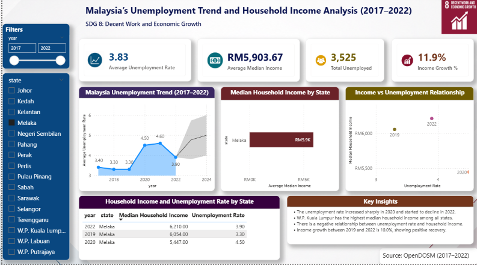

# Malaysia's Unemployment Trend & Household Income Dashboard (2017–2022)

An interactive Power BI dashboard analysing Malaysia's unemployment trends and household income across different states from 2017 to 2022.

This team project focuses on SDG 8: Decent Work and Economic Growth, providing insights into unemployment patterns and household income distribution in Malaysia.

## Dashboard Preview



## Project Objectives

- Analyse Malaysia's unemployment trends from 2017 to 2022.
- Examine median household income across Malaysian states.
- Explore the relationship between household income and unemployment rates.
- Present key findings through interactive Power BI visualisations.

## Dashboard Features

- **Key Performance Indicators (KPIs):** Average unemployment rate, average median household income, total unemployed and income growth.
- **Unemployment Trend Analysis:** Visualise changes in unemployment rates over time.
- **State Comparison:** Compare median household income across states.
- **Relationship Analysis:** Explore the relationship between household income and unemployment rates.
- **Interactive Filters:** Filter dashboard results by year and state.
- **Key Insights:** Summarise important findings from the analysis.

## Tools & Technologies

- Microsoft Power BI
- Microsoft Excel
- Data visualisation
- Data cleaning and analysis

## Project Structure

```text
malaysia-unemployment-income-dashboard/
├── dashboard/
│   └── Malaysia_Unemployment_Income_Dashboard (1).pbix
├── data/
│   ├── household_income_clean.xlsx
│   └── unemployment_statistics_clean.xlsx
├── screenshots/
│   ├── dashboard-preview.png
│   └── dataset-source.pdf
└── README.md
```

## Data Sources

The datasets used in this project are based on OpenDOSM data covering Malaysia's unemployment statistics and household income.

Source: [OpenDOSM – Department of Statistics Malaysia](https://open.dosm.gov.my/)

## Key Findings

The dashboard highlights unemployment trends, differences in median household income across states, and the relationship between income and unemployment.

The dashboard preview displays the following summary indicators:

- Average Unemployment Rate: 3.83%
- Average Median Household Income: RM5,903.67
- Total Unemployed: 3,525
- Income Growth: 11.9%

*Note: These figures represent the dashboard values shown in the project preview.*

## How to View the Project

1. Download or clone this repository.
2. Open the `.pbix` file using Microsoft Power BI Desktop.
3. Explore the dashboard using the year and state filters.

## Project Team

This dashboard was developed collaboratively as a team project. Shaza Batrisyia was one of the team members involved in the project.

The project is presented as a collaborative effort; individual task allocations are not specified here.
